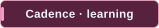
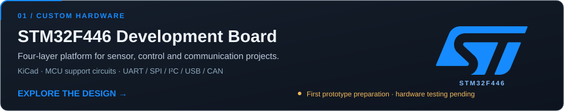
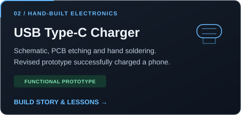
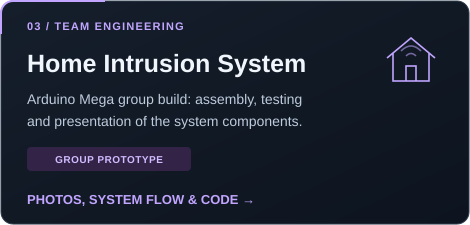

  

  
  
  

## 👋 About me

I'm **Arnold Ackom Oduro**, an **embedded electronics and R&D engineer**, currently an M1 student in **Bionanotechnology and Microelectronics at JUNIA ISEN, Lille**, through the KNUST / JUNIA 3+2 programme.

I enjoy turning ideas into schematics, PCBs and working prototypes, then figuring out what needs to change when the first attempt doesn't work. My focus is connecting **PCB design, firmware and hands-on hardware testing**.

- 🌍 From **Ghana**, now based in **Lille, France**.
- 🔧 Currently developing a **[four-layer STM32F446 board](docs/stm32-development-board.md)** for sensor, control and communication projects; hardware testing is the next stage.
- 🎯 Seeking a **3–4-month internship from May 2027** in embedded electronics, PCB design, hardware validation or electronics R&D.
- 🌱 Building my **C/C++ and STM32 skills**, learning **Cadence and Python**, and improving my French.

## 🛠️ Core stack

**Firmware & development**

  
  
  
  
  

**Hardware design & testing**

  
  
  

**Microcontrollers**

  
  

**Interfaces & protocols**

  
  
  
  
  

## Featured work

  

  
  

