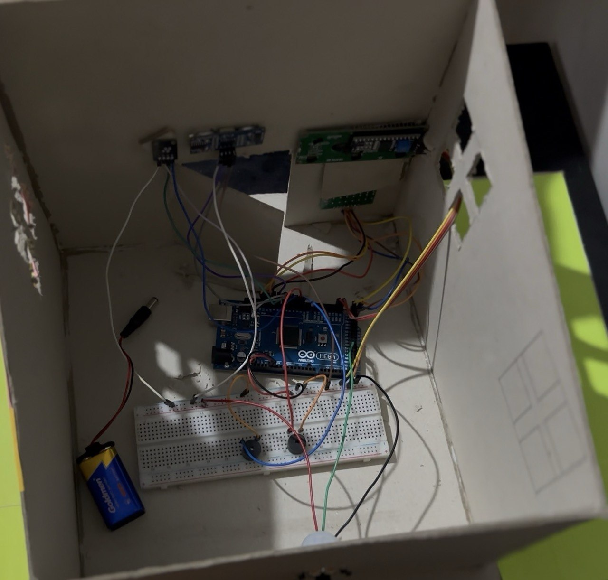
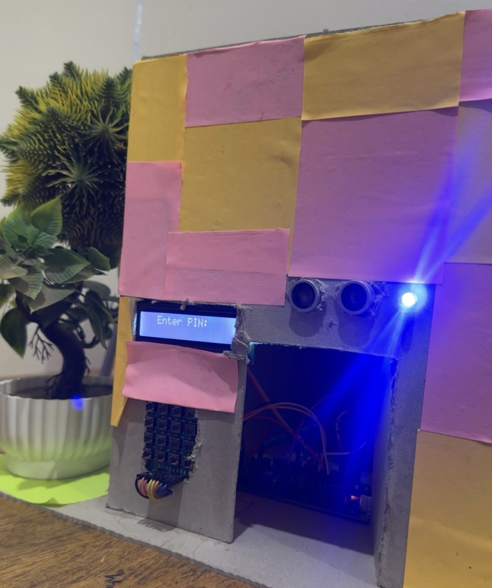
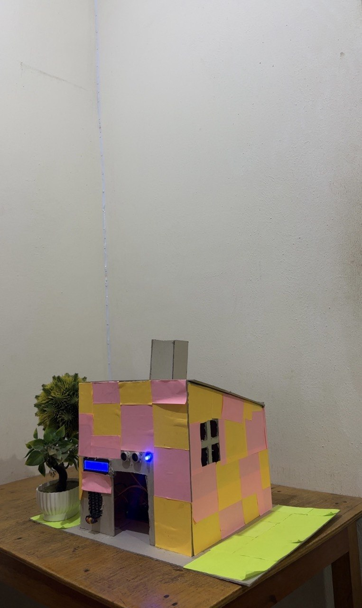
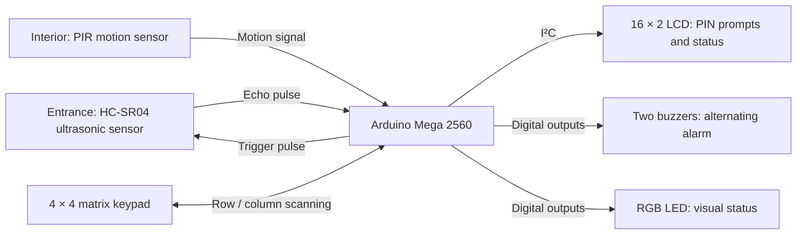
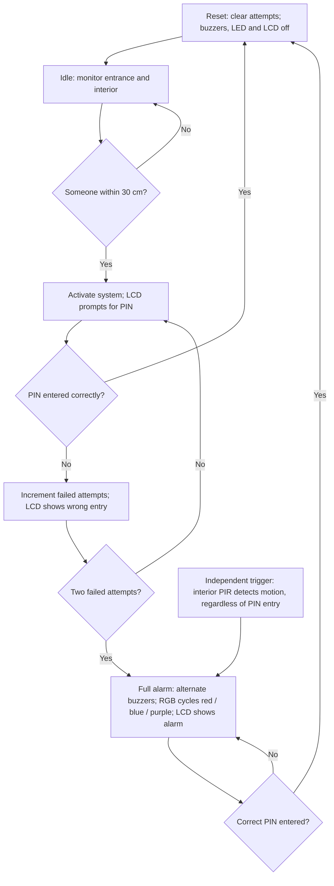

# Home Intrusion Detection System

[← Back to my profile](https://github.com/ackom-a-o)

**Arduino Mega · C++ / Arduino framework · Group project**

A home intrusion detection prototype built as a group project for COE 381 (Microprocessors) at KNUST. The system combines proximity and motion sensing with keypad PIN authentication, an LCD and local audible and visual feedback. The physical build used an Arduino Mega; the Tinkercad presentation shows an Uno-based simulation.

## My contribution

I collaborated on building and testing the prototype, and presented the components used and their roles in the system. The firmware and report are credited to the project team, COE 381 Group 4.

## Prototype photographs

<table>
  <tr>
    <td width="44%" valign="top">
      
       Internal assembly: controller, breadboard and wiring.
        
      
       Front interface with the LCD prompting for a PIN.
    </td>
    <td width="56%" valign="top">
      
       Complete model-house prototype built by the project team.
    </td>
  </tr>
</table>

Original photographs of the group build. Click a photo to view it at full size.

## Hardware and operation

| Component | Role |
|---|---|
| Arduino Mega 2560 | Reads inputs and controls system behaviour |
| HC-SR04 ultrasonic sensor | Detects nearby objects |
| PIR motion sensor | Detects movement |
| 4×4 matrix keypad | Accepts PIN input |
| 16×2 I²C LCD | Displays prompts and system status |
| RGB LED and two buzzers | Provide visual status and local alarm feedback |

The presentation video shows the assembled model-house prototype, keypad interaction, an illuminated LCD and changing status lights. The diagrams below document the operating behaviour described in our group presentation. They are a functional design reference; a pin-accurate wiring schematic still requires confirmation of the final connections.

## System architecture

The ultrasonic sensor monitors the entrance, while the interior PIR provides a separate intrusion trigger. The keypad accepts the PIN; the LCD, RGB LED and buzzers provide feedback.

## Operating flow

While waiting for input, the system stays in its current state. PIR detection overrides the normal PIN-entry sequence. A correct PIN clears the active sequence and returns the system to idle. The LCD backlight is off in idle and on for PIN prompts and alarm messages.

## Firmware and original group material

- [Original group repository](https://github.com/enkadi/Home-Intrusion-System)
- [Standalone C++ source](https://github.com/enkadi/Home-Intrusion-System/blob/b7dec187a0fdef24d7db9c69b55d3e5197c770e9/security_system.cpp)
- [Group report, including the Mega pin assignments and firmware listing](https://github.com/enkadi/Home-Intrusion-System/blob/b7dec187a0fdef24d7db9c69b55d3e5197c770e9/COE381%20Group4%20HomeIntrusionSystem.pdf)

The standalone source and report contain different firmware versions:

| Detail | Standalone source | Report listing |
|---|---|---|
| LCD | No LCD code | I²C LCD support |
| PIR input | Pin 2 | Pin 43 |
| Keypad columns | Pins 9–12 | Pins 22–25 |
| Timing | Uses blocking delays | Uses `millis()` for alarm effects, with blocking operations elsewhere |

The versions must be reconciled against the physical wiring and presentation flow before reuse. In particular, the presentation describes an immediate PIR alarm and a full alarm after two wrong PINs; the available listings handle these triggers differently. Neither has been newly compiled or hardware-tested as part of this portfolio review. No reuse licence was found in the inspected repository, so the original code and report are linked here rather than copied.

## Scope and next step

This was an educational prototype with local feedback. An ESP8266 Wi-Fi module and remote notifications were proposed future improvements and were not used in the physical build.

The next technical step is to confirm the final wiring and firmware version, then document repeatable tests for PIN handling, sensor triggers, alarm activation and reset.

## Team acknowledgements

Thank you to my COE 381 Group 4 teammates for the shared effort that brought this prototype together:

- Afia Kobi Ampem Afriyie
- Adomako Kwadwo Addo
- Agyemang Casper Adu-Gyamfi
- Adi Emmanuel Nana Kwame
- Addo Ofori Kojo Sakah Addo
- Amoani Charles Antwi
- Holyver Addai
- Akwasi Assensio Agyemang

Building, testing and presenting this system together was an important part of the learning experience. This project belongs to the team, and I am grateful to have contributed alongside them.
